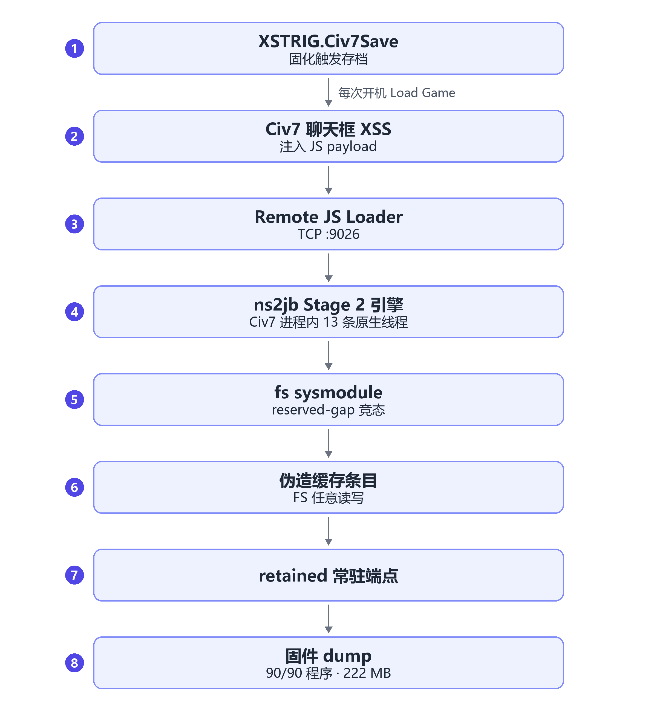

> 此项目通过Deepseek-V4.1-Pro协助完成

# CivSwitch × ns2jb 移植 —— 体验包

> 打包日期：2026-11-10。用途：在**自己的** Switch 2 上，从《文明 7》实体卡带入口走通
> ns2jb Stage 2 移植（slapah/CivSwitch fork，经我方 8 项补丁），获取 FS 任意读写，
> 并导出 90 个系统程序的固件 CodeFS（main.npdm + main）。
>
> 本包已经在我们的机器上全链验证：**RUN 38 全链闭环 + 固件 dump 90/90（222 MB）**。
> 你只需要一台满足前提的机器 + 照着下面的循环做。

## English Summary

**What this is** — a hands-on kit for a known Nintendo Switch 2 research chain. A
JavaScript-XSS in the *Civilization VII* (Switch 1 physical cart, v1.0.0) in-game
browser starts a Remote JS Loader on TCP `:9026`. The ns2jb Stage 2 engine then runs
inside the Civ7 process, races the `fs` sysmodule with 13 native threads and forges
cache entries to obtain arbitrary filesystem read/write; from there a retained payload
and an RO payload are installed and 90 system programs (222 MB of CodeFS) can be
dumped.

**Status** — fully validated on our own console: RUN 38 end-to-end, firmware dump 90/90.

**Requirements** — Switch 2 firmware 23.0.1; Civ7 Switch 1 physical cart v1.0.0; a
Switch 1 able to run homebrew (one-time install only); a Windows PC with Node.js ≥ 20
and Python 3.10+; both consoles wired to the same LAN.

**Per-boot success rate** — the runtime canary hits roughly 30% of boots; just reload
and retry (3–4 attempts typically enough).

**License** — GPL-2.0 for the package as a whole; upstream components, the bundled
`.nro` and the Gezine MIT portions are documented in [`NOTICE.md`](NOTICE.md) and
[`LICENSE-MIT-Gezine.txt`](LICENSE-MIT-Gezine.txt).

**Note** — research only, on hardware you own. Step-by-step instructions below are in
Chinese; the flowchart in §0 shows the chain at a glance.

> This project was built with assistance from **Deepseek-V4.1-Pro**.

---

## 0. 一句话原理

Civ7（Switch 1 版实体卡 1.0.0）聊天框存在 XSS：把一段 JS 打进游戏内嵌浏览器执行，
起一个 TCP `:9026` 的 Remote JS Loader。Loader 之上跑 ns2jb 的 Stage 2 引擎：
在 Civ7 进程里造 13 条原生线程对 `fs` sysmodule 打 reserved-gap 竞态，
伪造缓存条目拿到 FS 任意读写，再一路走到 retained 常驻端点 → RO payload →
固件 dump。**固化方式**：把触发代码写进 `XSTRIG.Civ7Save` 存档，每次开机 Load Game 即重新武装。

### 0.1 链路流程图



> 上图的可编辑源文件是 [`docs/flowchart.mmd`](docs/flowchart.mmd)（Mermaid 源码）。
> 该源码在其它 Mermaid 渲染器下正常，但 GitHub 页面实测报 `Unable to render rich display`，
> 因此 README 改用预渲染 PNG，保证在 GitHub 网页、手机端和任何 Markdown 查看器里都能显示。

## 1. 硬件 / 软件前提（缺一不可）

| 项 | 要求 |
|---|---|
| Switch 2 | 系统固件 **23.0.1**，⚠️ **不要再升级** |
| Civ7 卡带 | **Switch 1 实体版《文明 7》1.0.0**（带盒版初版，无更新） |
| Switch 1 | 可跑 homebrew `.nro`（用于**一次性**固化安装；装完可不用） |
| PC | Windows，**有线网线**直连 Switch 2 同一局域网（两端有线） |
| Node.js | ≥ 20（建议 22+） |
| Python | 3.10+（仅 save-tools 用，标准库即可） |
| 存档 | Civ7 的**单机存档可牺牲**（固化时会被清空；见 §4 警告） |

## 2. 目录结构

```
civswitch-kit/
├── README.md            本文件
├── CHANGES.md           我们对引擎的 8 项补丁清单
├── LICENSE              GPL-2.0 全文
├── LICENSE-MIT-Gezine.txt  原 MIT 文本（来自 Gezine 的部分）
├── NOTICE.md            来源、第三方二进制与再分发说明
├── run-p4-once.ps1      一键跑一轮 P4（恢复存档→起引擎→发 bridge→汇总）
├── set-pc-ip.ps1        一键把 PC 的 IP 写进 civ_bridge.js（首次必做）
├── port/                slapah 移植层（引擎 + 探针 + civ_bridge.js，已打补丁）
├── save-tools/
│   ├── restore_save.py      重写触发存档（每轮前用）
│   ├── dump_save_tree.py    全量备份 save:/saves（防身用）
│   ├── probe_9026.py        探测 loader 是否在线（慎用，见 §7）
│   ├── send_js.py           发任意 JS payload
│   ├── payloads/            示例 payload（helloworld.js 等）
│   └── trigger-recreate/    重建好的触发存档（XSTRIG.Civ7Save + manifest）
├── switch1/
│   └── civswitch-ldn-nx.nro  Switch 1 固化安装器（v0.9，我们实测验证版）
└── docs/
    ├── RUNBOOK-P4.md        标准循环 + 失败判读速查
    ├── SAVE-BACKUP.md       存档备份/恢复说明
    ├── PORT-HANDOFF.md      上游技术交接文档
    ├── FINDINGS.md          上游实测记录（SmileBASIC）
    ├── UPSTREAM-SYNC-2026-11-10.md  我们吸收的上游提交消化
    ├── flowchart.png        链路流程图（§0.1 引用的图片）
    └── flowchart.mmd        同一张图的 Mermaid 源码（可重新渲染）
```

## 3. Switch 1 侧安装（只做一次）

1. 把 `switch1/civswitch-ldn-nx.nro` 放到 Switch 1 的 SD 卡 `switch/` 目录，
   用任意 nro loader（hbmenu 等）启动。
2. Switch 1 与 Switch 2 **连同一 Wi-Fi**（此时 S1 用无线，后续 S2 用有线也行——
   LDN 阶段只发生在这一步）。

## 4. 固化安装（只做一次，⚠️ 会删存档）

1. S2：Civ7 → `MULTIPLAYER > WIRELESS > CREATE GAME > HOST LOBBY`（大厅保持开着）。
2. S1：运行 NRO → 按 **X** 扫描 → 方向键选到 S2 → 按 **A** 加入 →
   等屏幕出现 `Game lobby: JOINED`（S2 大厅里出现玩家 `CivSwitch-LDN-NX`）。
3. S1：按 **ZR**（一键固化）。S1 会自动：发 loader → 恢复 Wi-Fi → 扫局域网 →
   写触发存档 `XSTRIG.Civ7Save`。
4. 等 S1 显示 `Persistent trigger save installed` + `DONE`（以 **S2 屏幕打出
   `INSTALL DONE`** 为最终成功）。
5. ⚠️ **ZR 会删除 Civ7 全部单机存档**。成功后在 S2 重启游戏 → `Load Game` →
   触发存档 → 屏幕出现 `Awaiting payload at <IP>:9026` 即固化成功。
   之后每次开机 Load Game 都能重新武装，无需 Switch 1。

> 也可以不用 S1：用上游 Gezine 的 PicoSwitch 键盘宏方案（见上游仓库 README），
> 同样能达到固化效果。本包不含 Pico 固件。

## 5. PC 侧首次配置

```powershell
cd civswitch-kit
powershell -NoProfile -ExecutionPolicy Bypass -File .\set-pc-ip.ps1 -PcIp 你的PC局域网IP
```

（IP 查看：`ipconfig`，找以太网适配器 IPv4。此步把 IP 写进 `port\civ_bridge.js`，
是 console 端 bridge 出站连接的目标。）

## 6. 标准运行循环（每轮）

```
① S2 开机 → Civ7 → Load Game → XSTRIG.Civ7Save → 屏幕出现
   Awaiting payload at <S2-IP>:9026
② PC 执行（首次不跳过恢复，之后每轮都建议先恢复一次）：
   powershell -NoProfile -ExecutionPolicy Bypass -File .\run-p4-once.ps1 `
       -ConsoleIp <S2-IP> -PcIp <PC-IP>
③ 脚本顺序：重写触发存档（恢复原始字节）→ 起引擎 → 发 bridge → 等结束 → 打印汇总。
```

**重要（实测协议）**：存档恢复后要**再硬重启一次**才开跑——按这个顺序：

1. loader 在线时先跑一次 `restore_save.py`（run-p4-once 里第 1 步会自动做，
   或手动：`python save-tools\restore_save.py save-tools\trigger-recreate <S2-IP>`）；
2. **长按电源 12 秒硬关机 → 开机 → Load Game → Awaiting payload**；
3. 再跑 `run-p4-once.ps1 -ConsoleIp <S2-IP> -PcIp <PC-IP> -SkipRestore`。
4. 跑完一轮后 console 大概率卡死 → 回到第 2 步硬重启，循环。

**固件 dump**：加 `-FirmwareDump` 参数。dump 落盘 `port\engine\dumps\`
（`firmware-dump.json` 日志 + `ncm-system-programs.bin` + 每个 title 一个目录）。
注意：引擎每次启动会**清掉上一次的 dump 目录**，跑通后先拷贝走再跑下一轮。

## 7. 成功判据（只看 PC 端）

- `run-p4-once.ps1` 汇总：`verified=True`、`error=`（空）、engine exit=0；
- 引擎 stdout 出现：
  `FS execution verified. Original instructions restored and scratch cleaned up.`
  `Restart the console when finished.`
- 带 `-FirmwareDump` 时出现 `Firmware: dump complete: {"listed":90,...}`。

⚠️ **屏幕上的 `Executed successfully` / `Awaiting payload` 不代表成功**——
那是 bridge 会话正常收尾，成功失败都会显示。

## 8. 概率预期（重要）

- 每 boot 的 canary 命中约 **30%**；没命中就按 §6 循环再来（3-4 次必中一次）。
- 已知失败都在重试清单内（alias requalify / period copyField / 0-30 canary /
  native batch 不终止），都不是死结。
- `probe_9026.py` **少用**：空连接会被 loader 记 bad connection，3 次触发
  listener rebuild。
- 全程别动 S2 画面；卡死 >3 分钟视为 wedge → 长按电源 12 秒硬重启。
- Civ7 游戏内设置：自动存档**数量=1、回合间隔=25**（无法完全关闭，只能拉大）。

## 9. 安全与合规

- 仅供研究本人持有的设备；写入发生在 `save:/` 分区（触发存档、scratch 目录）。
- 跑之前用 `dump_save_tree.py` 备份一次存档（见 docs/SAVE-BACKUP.md）。
- 不要把本包用于他人设备或线上对战。

## 10. 来源与版本

- 上游：kurumuz/ns2jb（GitLab，GPL-2.0）→ slapah/CivSwitch（GitHub fork，
  `7d422e52`，ns2jb-port 移植层）→ 我们 8 项补丁（见 CHANGES.md）。
- Switch 1 安装器：xiaolizi23/civswitch-ldn-nx **v0.9**（我们全程实测版本；
  上游已出新版 v1.x，本包未包含）。SHA-256（同 `switch1/SHA256.txt`）：
  `4E8DDFA4982A8130470D0FCBD236F2954C5EE911F79FF581F4F1ECC01690A2D9`；
  该二进制按原样附带，上游未明确再分发许可，详见 `NOTICE.md`。
- 许可：本包整体 GPL-2.0；Gezine 的 MIT 片段原文本保留在 `LICENSE-MIT-Gezine.txt`。
- 我们的验证环境：S2 fw 23.0.1、Civ7 1.0.0 实体卡、PC Windows + Node 24、
  双端有线以太网。RUN 1→38 全过程见 NOTES（未包含在包内）。
